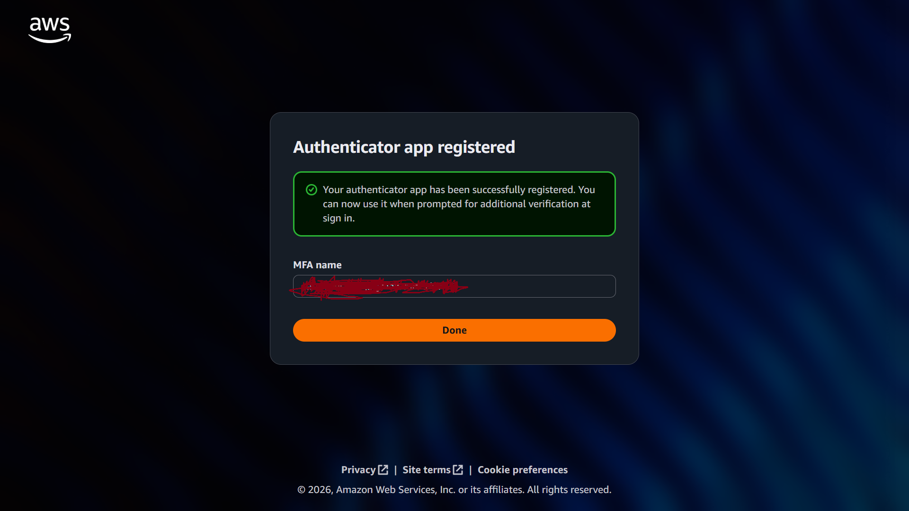

# AWS Account Setup & Security

## Project Overview

This project covered the initial setup and security of my AWS account. The focus was on protecting privileged access and understanding the available identity management options.

## Architecture & Resource Design

The project focused on the AWS account's root identity and the available account-level access management options.

## AWS Services & Configurations

- **AWS Account:** Created an AWS account for cloud infrastructure and security practicals.
- **Root User MFA:** Enabled multi-factor authentication to strengthen protection of the root account.
- 
- **AWS IAM:** Explored identity and access management options.
- **IAM Identity Center:** Examined the available access management features.

## Implementation & Key Decisions

I enabled MFA on the root user as an important account security measure.

I also explored creating an IAM administrative identity. However, the available account experience did not provide the expected console sign-in configuration, so I did not present an IAM administrative user as successfully configured.

## Security Considerations

- Protected root-user access with MFA.
- Recognised the importance of avoiding routine use of the root identity.
- Examined the role of IAM in managing access to AWS resources.

## Testing & Validation

- Confirmed that MFA was enabled on the root user.
- Reviewed the available IAM identity and account access options.

## Troubleshooting & Findings

The simplified AWS account experience did not expose all the IAM configuration options expected during the administrative user setup. IAM Identity Center features were also restricted in the available account experience.

This demonstrated that account-level feature availability can affect how identity management is configured.

## Lessons Learned

- The root user has extensive privileges and requires strong protection.
- MFA adds an important layer of security to privileged account access.
- IAM roles, users, and Identity Center serve different identity management purposes.
- Account feature restrictions should be understood before planning an implementation.

